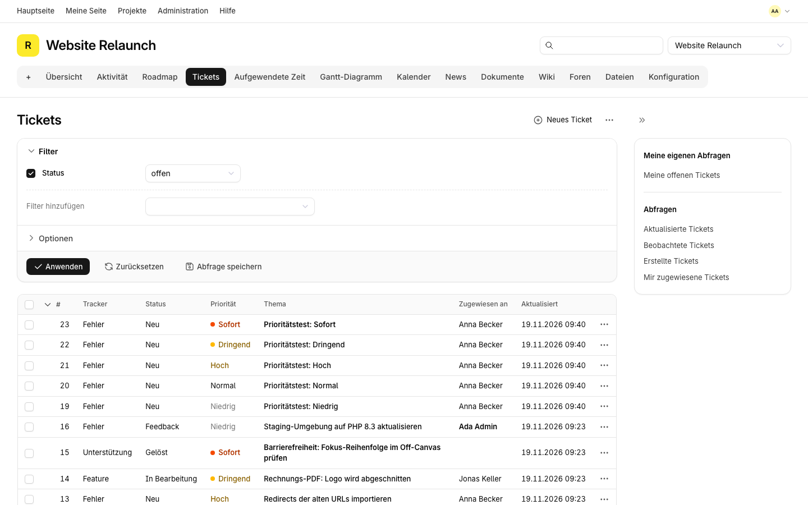
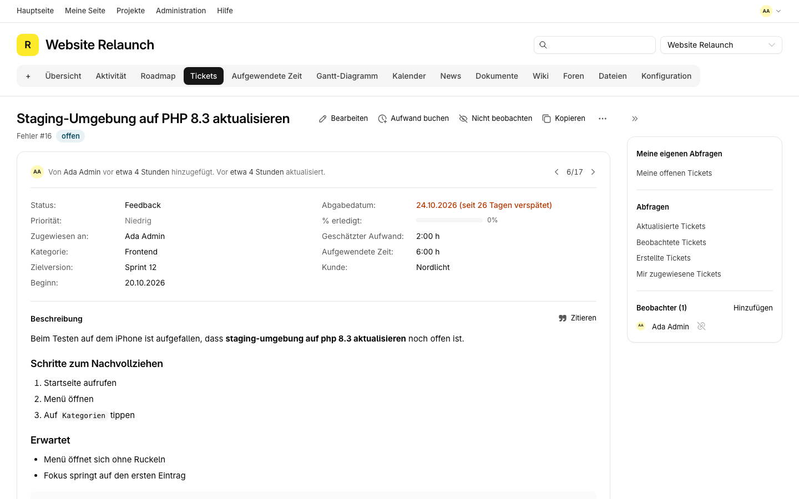
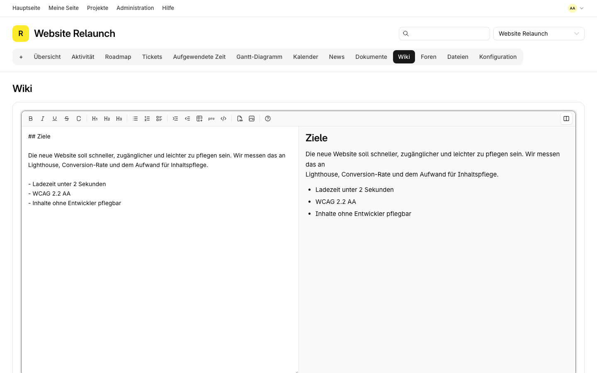
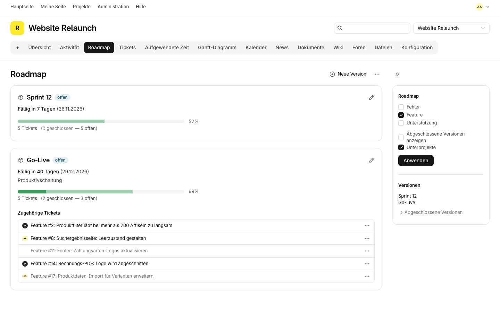
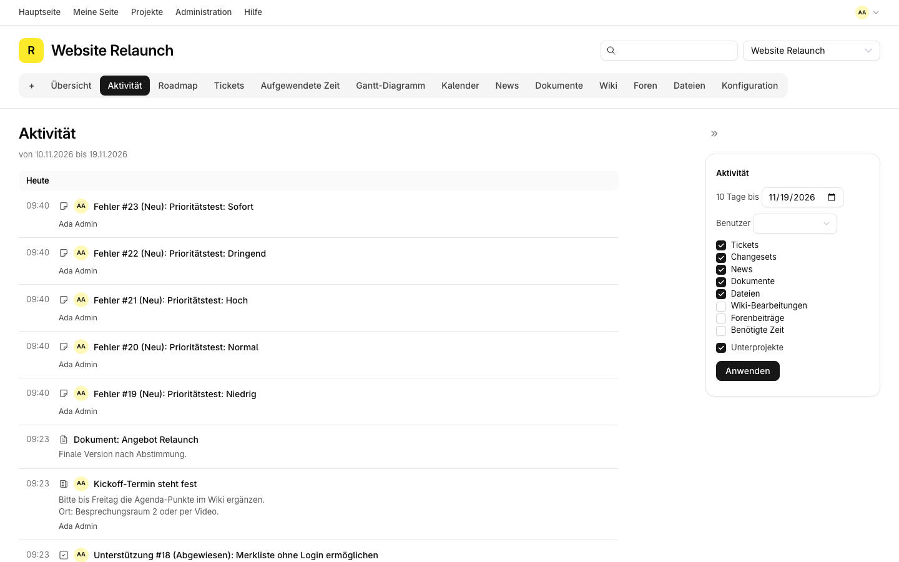
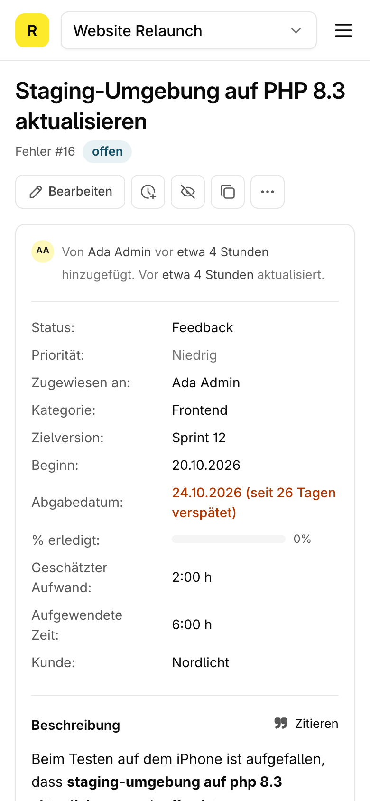
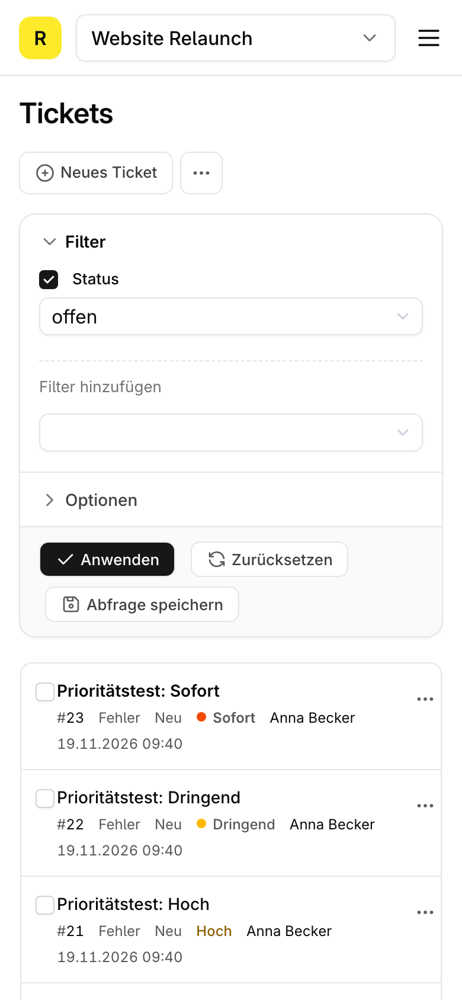
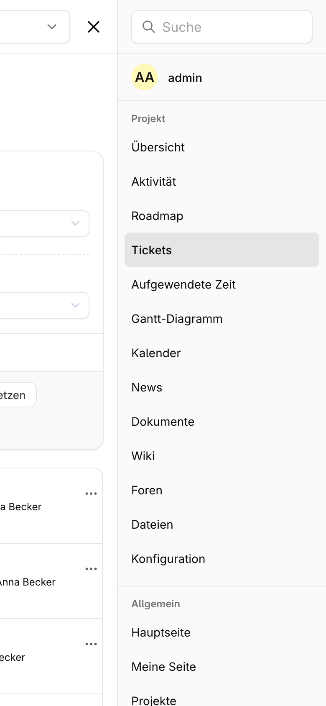

<p>
  
</p>

# Klar – a Redmine theme

A calm, clearly structured theme for Redmine. Neutral colours with a single yellow
accent, the Inter typeface and consistent spacing on a fixed grid – on desktop and
on mobile.

Klar does **not change Redmine's HTML**. Redmine's own CSS stays the foundation and is
selectively overridden: spacing, colours, typography, surfaces. Where CSS alone is not
enough, a small script fills the gap; without JavaScript Redmine keeps working as usual.

*"Klar" is German for "clear".*



| Issue | Text editor with live preview |
| --- | --- |
|  |  |
| **Roadmap** | **Activity** |
|  |  |

<p>
  
  
  
</p>

## What Klar changes

**Foundation**
- Inter typeface (self-hosted, no requests to Google Fonts), calm typography, tabular
  figures in numeric columns.
- Neutral grey scale with one yellow accent; states are shown with tinted surfaces and
  text colour instead of coloured borders.
- Consistent icons: characters Redmine renders as text (≡, ^, ×, ✓ …) are replaced by
  clean line icons, vertically centred with their labels.
- Inputs, selects, checkboxes and buttons share one style, with a clear focus ring.

**Header and navigation**
- Logo of your installation in the header (or a tile with the first letter of the
  application title), linking to "My page".
- Project menu as a quiet bar; the "+" menu can be reached reliably with the mouse.
- Sidebar on the right as an info panel, collapsible without uneven margins.

**Issues**
- The subject becomes the page heading; tracker, number and status sit underneath.
- Compact navigation between issues ("‹ 6/17 ›") inside the card.
- Attributes flow evenly in two columns, empty fields are hidden, the progress bar is
  aligned with its value.
- Priorities in graded colours (low muted, high to immediate warm).
- "Edit" as a separate surface with clear sections.

**Text editor**
- Live preview: next to the text on wide editors, below it on narrow ones – toggled by
  a button in the toolbar, the choice is remembered.

**Lists and pages**
- Filters as a card with a clear footer, calmer and more spacious tables.
- Activity, roadmap, calendar, Gantt, wiki, forums, "My page", login and administration
  in the same style; many small alignment issues fixed.

**Mobile**
- Header with logo, project selector and menu button; the menu is an animated side
  panel with separated sections.
- Lists as rows instead of wide tables, compact pagination.
- Forms with the label above the field and 16 px text (no zooming on iOS).

## Installation

The folder in `themes/` must be named `klar` – that is the name shown in Redmine's
theme selection.

**Release zip:** download `redmine-klar-theme-v*.zip` from the
[releases](https://github.com/stbt-de/redmine-klar-theme/releases) and unpack it in
the `themes/` directory (it contains the folder `klar/`):

```
cd /path/to/redmine/themes
unzip redmine-klar-theme-v1.0.0.zip
```

**Or clone:**

```
cd /path/to/redmine/themes
git clone https://github.com/stbt-de/redmine-klar-theme.git klar
```

Then restart Redmine (assets are compiled at startup) and select "Klar" under
*Administration → Settings → Display → Theme*.

### Tested with

| Redmine | Ruby | Rails | Checked |
| --- | --- | --- | --- |
| 7.0.3 | 4.0.10 | 8.1.4 | all pages on desktop and mobile, alignment check, plugin redmine-branding |
| 6.1.6 | 3.4.13 | 7.2.4 | all pages on desktop and mobile, alignment check, plugin redmine-branding |

Klar is built for Redmine 7. On Redmine 6.1 the top bar shows Redmine's plain
"Logged in as · My account · Sign out" links, because the account dropdown only exists
from Redmine 7 on. Older versions have not been tested.

### Your own logo

Redmine itself has no logo setting. Klar offers two ways:

- **Through the web interface** with the plugin
  [redmine-branding](https://github.com/stbt-de/redmine-branding): upload, replace or
  remove the logo (and favicon) under *Administration → Branding* – no server access
  needed. The plugin works with any theme; Klar picks up the logo and styles it itself,
  including on the login page. The plugin also lets you choose where the logo links
  to, as a default and per user.
- **As a file:** put `images/logo.png` into the theme folder (square, e.g.
  192 × 192 px) and restart Redmine. The file belongs to your installation, not to the
  theme – it is excluded via `.gitignore` and survives a `git pull`.

If both are set, the plugin's logo wins. Without a logo (or if it fails to load), a
yellow tile with the first letter of the application title is shown.

**Favicon:** Klar ships its own mark (`favicon/favicon.ico`). A custom favicon can be
uploaded with the redmine-branding plugin.

## Development

Requirements: Docker, Node.js.

```bash
npm install
docker compose up -d                                         # Redmine on http://localhost:3080
docker compose exec redmine bin/rails runner dev/seed.rb     # test data (admin / admin)

npm run reload        # build SCSS + JS, restart Redmine (assets are only picked up at startup)
npm run screenshots   # screenshots of all important pages to dev/screenshots/desktop
npm run screenshots -- issue --mobile   # only pages with "issue" in their name, 390 px wide
npm run screenshots:readme              # the screenshots of this README to docs/screenshots
npm run check:alignment                 # icons/rows vertically aligned? (desktop)
npm run check:alignment -- --mobile     # the same on mobile
```

`check:alignment` measures on every page whether icons are centred with their text and
whether the elements of a row (title row, actions, filter footer …) share one centre
line, and reports deviations above 1 px with their selector. It also checks that the issue
navigation ("‹ 12/17 ›") does not cover the author line, and on mobile that no fixed
element covers the open menu while the page is scrolled.

`stylesheets/*.css` and `javascripts/theme.js` are build output and are committed so
the theme can be installed without a build. Changes are made only in `src/scss/` and
`src/js/`; `npm run build` produces both.

To test another Redmine version: `REDMINE_VERSION=6.1 docker compose up -d`
(separate database per version, run `dev/seed.rb` once afterwards).

Code comments are written in German.

### Structure

```
src/scss/
├── application.scss     → stylesheets/application.css   (every page)
├── responsive.scss      → stylesheets/responsive.css    (mobile, after application.css)
├── context_menu.scss    → stylesheets/context_menu.css  (lists with context menu)
├── jstoolbar.scss       → stylesheets/jstoolbar.css     (text editor)
├── dropdown.scss        → stylesheets/dropdown.css      (Redmine 7+: account menu)
├── gantt.scss           → stylesheets/gantt.css         (Redmine 7+: Gantt chart)
├── variables/           tokens: colours, type, spacing, radii/shadows
├── mixins/              card, popover, focus ring, input, breakpoints, icons
├── base/                font (@font-face), typography, links, icons
├── layout/              top bar, header, main menu, content/sidebar, mobile
├── components/          buttons, forms, tables, tabs, flash messages, badges, …
├── pages/               issue, priorities, history, wiki, projects, roadmap, Gantt, …
└── mobile/              up to 899px: actions, lists as rows, issue, forms, …
                         (via responsive.scss so it applies after Redmine's responsive.css)

src/js/                  → javascripts/theme.js (esbuild)
├── theme.js              entry: starts the modules once the HTML is loaded
├── headerLogo.js         logo link in the header + fallback tile
├── issueSubjectTitle.js  issue view: subject as page title
├── editorLivePreview.js  text editor: preview on/off and live
└── footerCredit.js       footer: "Theme: Klar by stbt.de"
```

- Every entry file first imports its **Redmine original** and layers the changes on
  top. Redmine loads `responsive`, `context_menu`, `jstoolbar`, `dropdown` and `gantt`
  after `application.css`; that is why their changes live in separate files.
- Redmine loads exactly one script file from a theme, `javascripts/theme.js`; the
  modules are therefore split by task in `src/js/`.
- Redmine 7 uses CSS variables (`--color-header-background` …); the theme maps them to
  its tokens in `base/_typography.scss`.
- Values never live directly in components: global tokens in `variables/`, area
  specific values in the variables file next to it (e.g.
  `components/variables/_tablesVariables.scss`).
- Colours only via semantic tokens (`$colorTextMuted`, `$colorBorder`, …), spacing as
  multiples of `$space`.
- Layers (`z-index`) are defined centrally in `$zLayers`
  (`src/scss/variables/_theme.scss`); add new layers there, no magic numbers.
- No all-caps text, no coloured accent borders: states via tinted surfaces and text
  colour.

## Built with AI assistance

Klar was developed together with an AI coding assistant (Claude Code by Anthropic).
Most of the code was written by the assistant; the direction, design decisions and
review came from [stbt.de](https://stbt.de/). Every change was checked in a running
Redmine – with screenshots and the automatic alignment check described above.

## License

MIT, see [`LICENSE`](LICENSE). The Inter typeface in `fonts/` is licensed under the
SIL Open Font License 1.1 (`fonts/LICENSE-Inter.txt`). The line icons follow Tabler
Icons (MIT).
